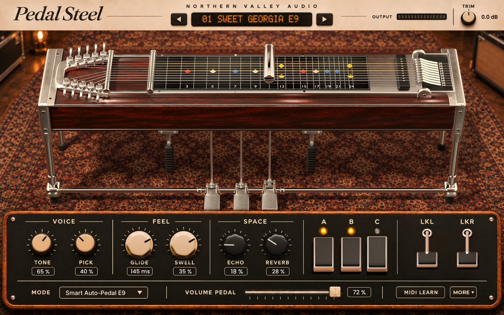

# NVA Pedal Steel (`Nvps`)

**NVA Pedal Steel** is a C++20 / JUCE 8 MIDI & MPE-playable Nashville E9th 10-String Pedal Steel Guitar instrument plugin (`VST3` and `Standalone`).



## Highlights

- **Concert-Calibrated 44.1 kHz Stereo Studio Bank + Physical E9th String Engine**:
  - **26 de-chorded, concert-A440-calibrated, zero-crossing seamless stereo multi-sample zones** (`G3–A5`) plus **20 full-fidelity studio performance & lick slices** (`102.7 seconds` total 44.1 kHz 16-bit stereo studio audio embedded directly in the binary—zero external sample folders required).
  - **Dual-Bus Studio / Physical Architecture**: Pure studio recordings pass through delta-calibrated tone shaping (`0.0 dB` transparent at reference baseline so studio room air and pickup character are never double-filtered), while physical 16-harmonic E9th dispersion, real fingerpick transients, chrome-bar winding slide sheen, sympathetic cabinet resonance, and asymmetric 12AX7 Tweed saturation blend seamlessly underneath.
- **10-String Nashville E9th Mechanical Copedent**:
  - Authentic 10-string open tuning (`F#4, D#4, G#4, E4, B3, G#3, F#3, E3, D3, B2`) with real bellcrank string-pull matrix for **Pedal A** (`+2` on `B` strings), **Pedal B** (`+1` on `G#` strings), **Pedal C** (`+2` on `E/B`), **LKL** (`+1` `E -> F`), **LKR** (`-1` `E -> D#`), **A+B Emmons/Day Slant** (`I -> IV` / `vi`), mechanical cabinet drop, and delayed wrist-roll tonebar vibrato.
- **5 Playable Performance Modes**:
  1. **Smart Auto-Pedal E9**: Automatically assigns chord roots, thirds, fifths, and 6th/9ths to their true E9th copedent roles so live keyboard triads & 7th chords bend obliquely with Pedals A/B/C and Knee Levers.
  2. **Crying Lead Gliss**: Expressive single-string legato transfers with 2nd-order critically damped chrome-bar glide inertia and upward bellcrank scoops.
  3. **Lush Swell Pad**: Velvet Goodrich optical volume-pedal chord swells with softened pick transients.
  4. **Manual Pedals Only**: Pure manual copedent workstation controlled via CCs, keyswitches, MPE, or UI buttons.
  5. **Studio Phrase Licks**: Chromatically maps and transposes real recorded Nashville, Bootgaze, Tweed, and Montana pedal-steel licks across the entire MIDI keyboard.
- **DAW Host Tempo-Synced Analog Tape / BBD Delay & Dattorro Figure-8 Plate Reverb**:
  - Quadrature-modulated Echoplex tape echo (`SYNC` locks to DAW `AudioPlayHead` BPM across `1/16`, `1/8T`, `1/8`, `1/8D`, `1/4`, `1/4D`) with dynamic phrase & pedal-slant harmonic ducking, feeding a wide figure-8 stereo plate reverb.
- **6 Modern Producer Analog Character Circuits**:
  - Dedicated first-principles hardware modeling for modern Indie, R&B, Film-Score, and Psych-Soul production alongside classic studio steel: **Tascam 424 4-Track Cassette** (`3.45 kHz` 4-pole tape roll-off + dual-capstan wow/flutter + dynamic preamp sag), **Phase-Pure Dual-Sine Studio Silk Chorus** (`6.2 kHz` condenser air), **Eno/Lanois *Apollo* `-12st` Bowed Cello Sub-Octave + Dark `1.48 kHz` Velvet `+12st` Shimmer**, **Accutronics 3-Spring Tank Drip + Deep Fender Vibrolux Optical Bias Tremolo**, **24 dB/oct `1.35 kHz` Resampled Alt-R&B Underwater Filter**, and **Boss VB-2 `1.55 Hz` Analog Pitch Vibrato + Stereo CE-2 + 12AX7 Tube Honey**.
- **Full Studio QOL & Interactive UI**:
  - **Interactive 10-String Fretboard**: Click any string to pluck and drag horizontally across frets `0–24` to slide the solid chrome bar in real time.
  - **18 Factory Presets** with `<`/`>` quick-steppers, `PLAY LICK` & `E / G / D / C` chord audition buttons, live stereo `L/R` peak meter, resizable vector UI (`1020×660` to `1560×980`), hover tooltips, and full DAW state persistence.

## MIDI, Keyswitch & MPE Reference

| Input | Function |
| :--- | :--- |
| **Notes `C0–G0` (`MIDI 24–31`)** | Momentary Copedent Keyswitches (`C0`=Pedal A, `C#0`=Pedal C, `D0`=Pedal B, `E0`=A+B Slant, `F0`=LKL, `G0`=LKR) |
| **Notes `C1–G1` (`MIDI 36–43`, Ch 1)** | Studio Phrase Lick Keyswitches (`C1`=Lick 1, `D1`=Lick 2, `E1`=Lick 3, `F1`=Lick 4, `G1`=Full Studio Performance) |
| **Notes `G#1+` (`MIDI 44+`, Ch 1)** | Polyphonic 10-String E9th Chromatic / Copedent / Lick Performance |
| **MPE (`MIDI Ch 3–16`)** | Per-note independent oblique pitch bends (`±12` semitones) + Channel Pressure / Poly Aftertouch vibrato expression |
| **`CC 1` (Mod Wheel)** | Smooth **A + B Pedal** slant (`I -> IV` / `vi` suspension) |
| **`CC 7` / `CC 11`** | **Goodrich Optical Volume Pedal** swell |
| **`CC 64` (Sustain Pedal)** | Natural 10-string damper sustain |
| **`CC 65 / 66 / 67 / 68 / 69`** | Continuous **Pedal A / Pedal B / Pedal C / LKL / LKR** control |
| **`Pitch Wheel` (Ch 1)** | Solid Chrome Tonebar glissando (`±7` semitones) with hand/bar mass inertia |

## Building

Requires CMake 3.22+, Visual Studio 2022 (or Clang/Xcode), and JUCE 8.

```powershell
cmake -B build -DCMAKE_BUILD_TYPE=Release
cmake --build build --config Release --parallel 8
```

Pre-built Windows x64 release binaries are also included in [`dist/`](dist/):
- **VST3**: `dist/NVA Pedal Steel.vst3`
- **Standalone**: `dist/NVA Pedal Steel.exe`
